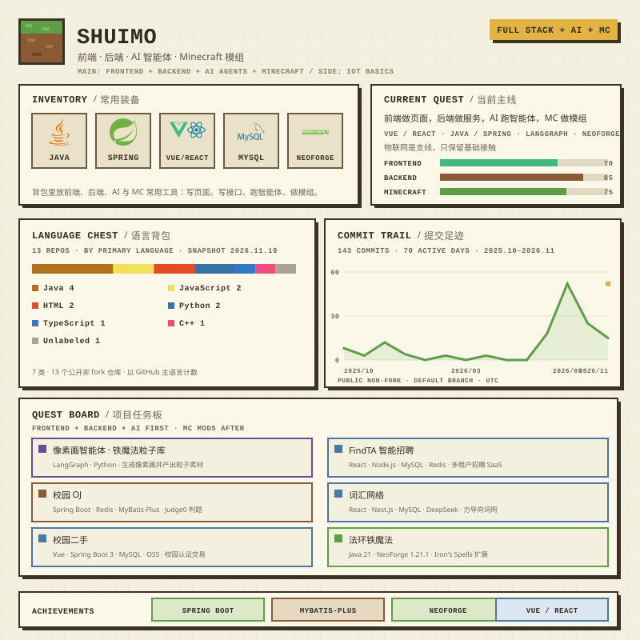

<a href="https://shuimo0413.github.io/">
  <picture>
    <source media="(max-width: 600px)" srcset="https://raw.githubusercontent.com/shuimo0413/shuimo0413/3b77b9133bed0bc3ddb9c7c2ab8dff6530d307c6/assets/profile-mc-mobile.svg" />
    
  </picture>
</a>

**前端 / 后端 / AI 智能体 / Minecraft 模组**

[博客](https://shuimo0413.github.io/) · [邮箱](mailto:1743355601@qq.com) · [GitHub](https://github.com/shuimo0413)

